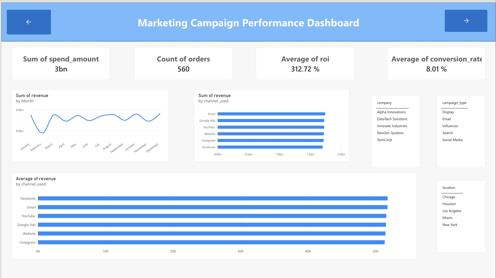
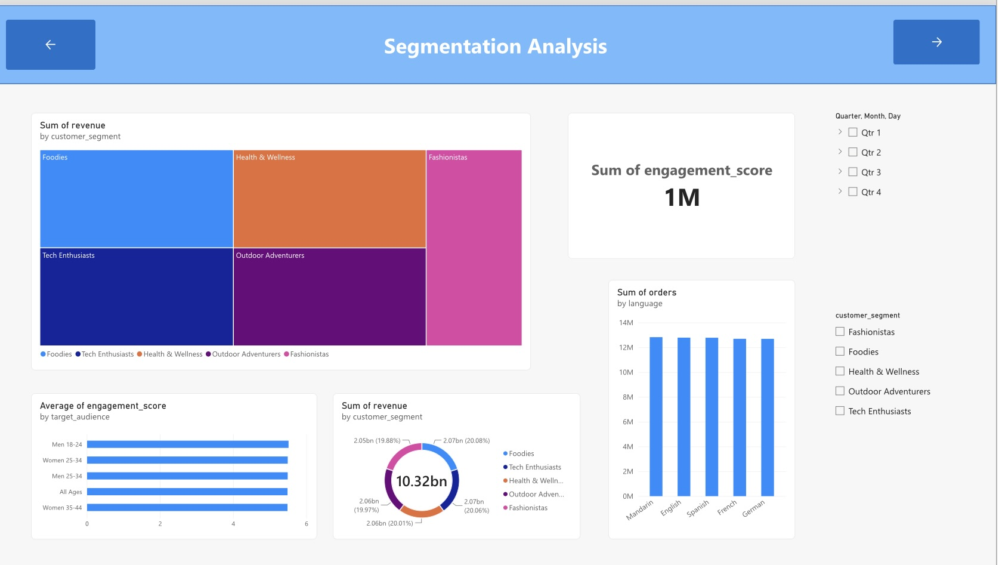
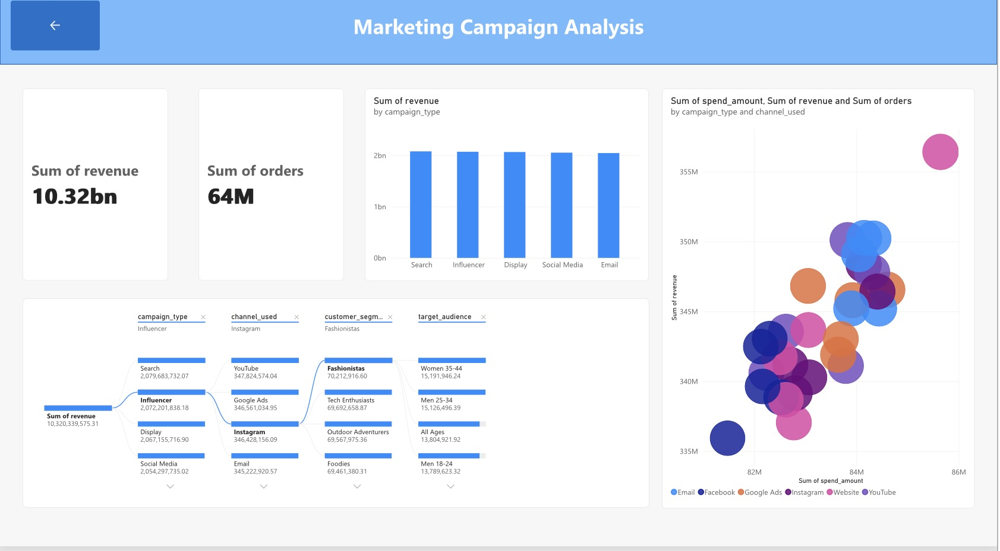

# Marketing Campaign Performance Dashboard

An interactive **Power BI** dashboard that shows how marketing campaigns performed across channels, campaign types and customer segments. The dashboard turns about 200,000 campaign records into clear insights and simple recommendations.



## Project Goal

Answer these business questions:

1. How much revenue do the campaigns earn compared with how much they cost?
2. Which campaign types and channels perform best?
3. Which customer segments bring the most revenue?
4. Where should the marketing budget go next?

## Key Results

| Measure | Result |
|---|---|
| Total revenue | 10.32bn USD |
| Total spend | 2.50bn USD |
| Revenue per 1 USD spent | 4.13 USD |
| Average ROI | 3.13 |
| Total orders | 63.8M |
| Average conversion rate | 8.01% |
| Average engagement score | 5.49 / 10 |

## Key Findings

- **Campaigns are profitable.** Every 1 USD spent brought back 4.13 USD in revenue (an ROI of 3.13 means 3.13 USD of profit per 1 USD spent).
- **Revenue is steady all year.** Monthly revenue stays between about 850M and 880M. The dip in February comes from the shorter month. Revenue per day is about 28M in every month.
- **No campaign type clearly wins.** Search (2.08bn) is highest and Email (2.05bn) is lowest. The gap is only 1.6%.
- **No channel clearly wins.** Email (1.74bn) is highest and Facebook (1.70bn) is lowest. The gap is about 2.4%, and revenue per 1 USD spent is between 4.11 and 4.14 on every channel.
- **All customer segments are equal.** Each of the 5 segments brings about 20% of revenue.
- **Cost per order is almost the same everywhere** (about 39 USD). YouTube is the cheapest at 38.85 USD and Email is the highest at 39.52 USD.

## Recommendations

1. Keep the budget balanced. The data gives no reason to move all the money to one channel or campaign type.
2. Test a small budget shift toward YouTube, which has the lowest cost per order.
3. Compare options by efficiency (cost per order, revenue per 1 USD spent), not only by total revenue.
4. Look deeper by company, location and target audience, where differences may be larger.
5. Work on engagement. The average score of 5.49 out of 10 leaves room to improve the content.
6. Compare months using revenue per day, so short months do not look like a drop.

## Dashboard Pages

| Page | What it shows |
|---|---|
| **Navigation** | Starting page with buttons to move around the report |
| **Dashboard** | KPI cards, revenue by month, revenue by channel, slicers for company and campaign type |
| **Segmentation** | Revenue by customer segment (treemap and donut), engagement by target audience, orders by language |
| **Campaign Details** | Decomposition tree of revenue, and a scatter chart of spend vs revenue by campaign type and channel |




## Interactive Features

- Slicers and filters for company, campaign type, customer segment and date
- Cross-filtering: click a bar or segment and the other visuals update
- Page navigation buttons
- Decomposition tree to explore revenue step by step
- Scatter chart to compare spend, revenue and orders

## Data

The project uses three course-provided marketing datasets:

| File | Content |
|---|---|
| `marketing_campaign_dataset.csv` | Campaign type, channel, audience, location, language, clicks, impressions, engagement score, ROI, conversion rate, date |
| `Sales_Results.csv` | Revenue and orders for each campaign |
| `Channel_Spend.csv` | Spend amount, CPM and CPC for each campaign |

Each file has 200,000 rows, and every `campaign_id` appears once in each file.

### Data preparation

1. Joined the three files into one table (`Marketing_Combined.csv`) using `campaign_id`. No rows were lost.
2. Converted `duration` from text such as "30 days" to a number.
3. Removed the `$` sign and commas from money columns.
4. Fixed the date format. The dates are in MM/DD/YYYY format, which is different from the dataset description.
5. Removed two empty columns from the sales file and one duplicate cost column.
6. Renamed the sales click column to `sales_total_clicks` so it is not mixed up with `clicks`.
7. Checked that `conversion_rate` is stored as a fraction (0.08 = 8%).

## Limitations

- The groups are very close in performance, so small differences may be normal variation and not a real winner.
- The data covers one year (2021). It shows what happened, not why it happened.

## Tools

- Power BI (data loading, visuals, interactivity)
- Python and pandas (checking data quality and joining the files)

## Files

```
├── README.md
├── Marketing_Dashboard.pbix
├── dashboard.jpeg
├── segmentation.jpeg
└── campaign-details.jpeg
```

## Author

**Sandun Lakshan Ranathunga**
Undergraduate student, Business Analytics
